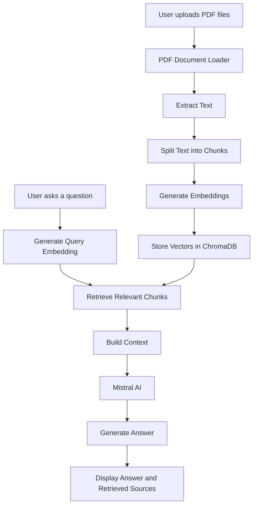

# 📚 RAG PDF Reader — Chat with Your Documents

An AI-powered PDF question-answering application that allows you to upload documents and ask questions in natural language. It uses **Retrieval-Augmented Generation (RAG)** to retrieve relevant passages from your PDFs and generate context-aware answers using Mistral AI.

🔗 **Live Demo:** [Try RAG PDF Reader](https://rag-pdf-reader-01-22.streamlit.app/)

💻 **GitHub Repository:** [RAG-PDF-Reader](https://github.com/RisabhPandey/RAG-PDF-Reader)

---

## ✨ Features

- 📄 **Multiple PDF Uploads** — Upload one or more PDF documents.
- 💬 **Conversational Q&A** — Ask questions about the uploaded documents in plain English.
- 🧠 **Retrieval-Augmented Generation (RAG)** — Retrieve relevant document passages before generating answers.
- 🔎 **Semantic Search** — Find relevant content using vector embeddings rather than relying only on exact keyword matches.
- 🗄️ **Vector Storage** — Use ChromaDB to store document embeddings and retrieve relevant chunks.
- 🤖 **Mistral AI Integration** — Generate natural-language responses using a Mistral language model.
- 📑 **Source Transparency** — Expand the retrieved sources section to inspect passages used to answer your questions.
- 🎨 **Interactive UI** — A Streamlit interface with dark and light themes.

## 🛠️ Tech Stack

| Technology | Purpose |
|---|---|
| Python | Core programming language |
| Streamlit | Interactive web application |
| LangChain | RAG pipeline orchestration |
| Mistral AI | Language model for answer generation |
| Hugging Face | Text embedding generation |
| Sentence Transformers | Semantic text representations |
| ChromaDB | Vector database and similarity search |
| PyPDF | PDF document loading and text extraction |
| RecursiveCharacterTextSplitter | Splitting documents into smaller chunks |
| python-dotenv | Loading environment variables |

## 🏗️ Architecture



### How It Works

1. **Document Upload:** The user uploads one or more PDF files.
2. **Text Extraction:** The PDF loader extracts text from the uploaded documents.
3. **Text Chunking:** The extracted text is divided into smaller chunks for efficient retrieval.
4. **Embedding Generation:** Hugging Face embeddings convert text chunks into numerical vectors.
5. **Vector Storage:** ChromaDB stores the vectors for similarity-based retrieval.
6. **Question Processing:** The user's question is converted into an embedding.
7. **Context Retrieval:** The system retrieves relevant document chunks from the vector store.
8. **Answer Generation:** The retrieved context is passed to Mistral AI to generate a response.
9. **Source Inspection:** The user can expand the retrieved sources section to review relevant passages.

## 🚀 Getting Started

Follow these steps to run the project locally.

### Prerequisites

- Python 3.12 recommended for a compatible ML dependency environment.
- Git
- A Mistral AI API key
- Internet access for API requests and initial model downloads

### 1. Clone the Repository

```bash
git clone https://github.com/RisabhPandey/RAG-PDF-Reader.git
cd RAG-PDF-Reader
```

### 2. Create a Virtual Environment

**Windows — PowerShell**

```powershell
py -3.12 -m venv .venv
.\.venv\Scripts\Activate.ps1
```

**Linux / macOS**

```bash
python3.12 -m venv .venv
source .venv/bin/activate
```

### 3. Install Dependencies

```bash
python -m pip install --upgrade pip
pip install -r requirements.txt
```

### 4. Configure Environment Variables

Create a `.env` file in the project root directory:

```env
MISTRAL_API_KEY=your_mistral_api_key_here
```

Replace the placeholder with your own API key from [Mistral AI](https://console.mistral.ai/).

> **Security:** Never commit your `.env` file or expose your API key in your source code or public repository.

Make sure `.env` is included in your `.gitignore` file.

### 5. Run the Application

```bash
streamlit run app.py
```

Open the local URL displayed in your terminal, usually:

`http://localhost:8501`

## 📖 How to Use

1. Open the [live application](https://rag-pdf-reader-01-22.streamlit.app/).
2. Upload one or more PDF documents.
3. Click **Process PDF(s)** and wait for document processing to finish.
4. Ask a question related to the uploaded documents in the chat interface.
5. Read the generated answer.
6. Expand **View Retrieved Sources** to inspect the document passages retrieved for your question.
7. Ask follow-up questions as needed.

**Example questions:**

- Summarize the main ideas of this document.
- Explain a particular concept in simple language.
- What are the key points discussed in Chapter 2?
- Find the important definitions in the uploaded notes.
- Compare two concepts described in the documents.

## 🔐 Environment Variables

| Variable | Description |
|---|---|
| `MISTRAL_API_KEY` | API key used to access Mistral AI |

Keep all API credentials private. For deployment, configure secrets through your hosting platform rather than committing credentials to GitHub.

## ☁️ Deployment

The project is deployed using **Streamlit Community Cloud**.

- **Live Application:** [rag-pdf-reader-01-22.streamlit.app](https://rag-pdf-reader-01-22.streamlit.app/)
- **Source Code:** [GitHub Repository](https://github.com/RisabhPandey/RAG-PDF-Reader)

To deploy your own instance:

1. Push your project to a GitHub repository.
2. Sign in to [Streamlit Community Cloud](https://share.streamlit.io/).
3. Create an app and select your repository, branch, and `app.py` as the entry point.
4. Add `MISTRAL_API_KEY` under the app's secrets settings.
5. Deploy the application and check the logs if dependency installation fails.

## 📂 Project Structure

```text
RAG-PDF-Reader/
│
├── app.py                  # Main Streamlit application
├── main.py                 # Additional application entry point
├── create_db.py            # Database creation utility
├── requirements.txt        # Python dependencies
├── .env                    # Local environment variables (not committed)
├── .gitignore              # Files excluded from Git
│
├── Document loaders/       # Document loading components
├── retrievers/             # Retrieval components
├── Vector Store/            # Vector store components
├── V-Runnables/             # Runnable pipeline components
├── chroma-db/               # Local vector database data
└── README.md
```

*Note: Folder names and responsibilities may vary slightly depending on the current repository structure.*

## ⚠️ Limitations

- Answer quality depends on the quality of the PDF text, retrieval results, and language model.
- Scanned PDFs may require OCR if their pages do not contain extractable text.
- Large documents may take longer to process and embed.
- Mistral AI usage is subject to API availability, rate limits, and applicable pricing.
- AI-generated answers may contain mistakes. Verify important information against the original documents.
- The hosted app may have resource limits and may not retain uploaded documents or vector data indefinitely.

## 🔮 Future Improvements

- [ ] Add conversation history and improved follow-up question handling.
- [ ] Add page numbers and document names to retrieved citations.
- [ ] Support scanned PDFs using OCR.
- [ ] Add more embedding models and LLM providers.
- [ ] Improve retrieval using reranking and hybrid search.
- [ ] Add document management and persistent storage.
- [ ] Add support for additional document formats.
- [ ] Add automated tests and improved error handling.

## 🎯 Learning Outcomes

This project explores practical applications of:

- Retrieval-Augmented Generation (RAG)
- Large Language Models (LLMs)
- Text embeddings and semantic search
- Vector databases
- LangChain pipelines
- PDF processing
- AI application development and cloud deployment

## 👨‍💻 Author

**Risabh Pandey**

- GitHub: [@RisabhPandey](https://github.com/RisabhPandey)
- Project Repository: [RAG-PDF-Reader](https://github.com/RisabhPandey/RAG-PDF-Reader)
- Live Demo: [Try the Application](https://rag-pdf-reader-01-22.streamlit.app/)

---

If you find this project useful, consider giving the repository a ⭐ on GitHub!

*Built to make learning and working with long PDF documents easier through AI-powered retrieval and question answering.*